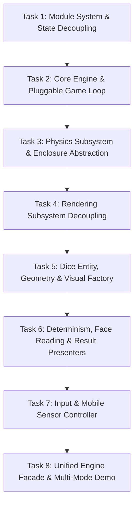

# Modular 3D Dice Game Engine: Architecture Plan & Implementation Roadmap

## 1. Executive Summary & Vision

The objective of this plan is to refactor the existing 3D dice simulation repository (`dice-playground`) into a clean, modular, and extensible **Physics Game Engine**. 

Currently, the codebase contains rich, working capabilities:
- Procedural D6 chamfered mesh generation and dynamic canvas texture mapping.
- Realistic rigid-body physics simulation using Cannon.js with contact friction and restitution.
- Fast-forward physics simulation enabling pre-determined, deterministic dice rolls (shifting face textures while preserving natural trajectory).
- Mouse drag/flick throw gestures, raycast mouse picking, and experimental mobile sensor listeners.

However, these capabilities are tightly coupled inside monolithic singletons, global variables, and an inflexible animation loop. 

This plan details the reorganization of the repository into modular subsystems so that future features can be plugged in without modifying core engine code:
1. **Custom Boundary Enclosures**: Running dice inside a sphere, a cube, a water glass (cylinder), or a traditional dice tray.
2. **Dynamic Physics & Environment**: Modifying gravity vectors, surface friction, restitution, and damping on the fly.
3. **Swappable Game Loops**: Switching between **Standard Turn-Based Roll** (throw -> settle -> calculate -> report), **Continuous Motion Sandbox** (unending physics simulation reacting in real time to phone tilt, gyro, and shake), or headless instant calculation.
4. **Decoupled Presentation & Sensors**: Pluggable UI presenters (banner display, silent, custom HUD) and pluggable input sources (touch/mouse flicks, accelerometer/gyroscope, programmatic triggers).

---

## 2. Current Codebase Findings & Detailed Inventory

### 2.1 File-by-File Inventory

| File Path | Module Type | Current Responsibility | Architectural Limitations / Issues |
| :--- | :--- | :--- | :--- |
| `dice/index.html` | HTML Entry | Loads scripts, Three.js, Cannon.js, styles, and initializes `dice_initialize`. | Mixes `<script type="text/javascript">` (globals) with `<script type="module">`. |
| `teal.js` | ES Module | DOM helper library (`$t`) providing element creation, event binding, cloning, URL param parsing, and RPC. | Legacy DOM helper; contains unused RPC stubs; mixes presentation and utility logic. |
| `dice/main.js` | ES Module | High-level bootstrapping, URL parameter reading, DOM element binding, camera debug hooks. | Hardcodes bindings to missing HTML IDs (`#clear`, `#inX`, `#inY`, `#inZ`, `#control_panel`); orphaned result handling. |
| `dice/dice.js` | ES Module | `DiceBox` class: animation loop, physics step, settle detection, mouse drag handling, sensor binding, throw orchestration. | Monolithic god class; couples loop, physics, input, sensor events, and UI debug output (`middleDiv`). Contains bugs (e.g. `shift_dice_faces` missing `this.`). |
| `dice/objects/options.js` | Plain Script (Global) | Configuration object containing colors, shadow settings, frame rate, continuous rolling toggle, material options. | Stored in global window scope; not imported/exported; mutations affect all components without reactivity. |
| `dice/objects/playingField.js`| Plain Script (Global) | Calculates 2D container dimensions, aspect ratios, scale, and wall height. | Global singleton; assumes full-screen DOM container; directly referenced inside physics and geometry. |
| `dice/objects/rndGen.js` | Plain Script (Global) | Random number generator wrapper with stub for remote `random.org` RPC calls. | Global singleton; couples random math with `$t.rpc` and DOM helpers. |
| `dice/objects/physics.js` | ES Module | Configuration object for gravity, mass, inertia, friction, and restitution coefficients. | Static configuration object; rigid structure tied only to table desk and 4 barriers. |
| `dice/objects/world.js` | ES Module | Cannon.js simulation world singleton (`world.instance`), creates static plane colliders for desk and 4 walls. | Hardcoded singleton; boundary colliders are hardcoded infinite planes directly reading global `playingField`. |
| `dice/objects/scene.js` | ES Module | Three.js scene singleton (`scene.instance`), camera, renderer, spotlight, ambient light, desk floor mesh. | Hardcoded singleton; directly bound to global `playingField` and `options`; mixes rendering with DOM debug panels (`SettingsRenderer`). |
| `dice/objects/diceFactory.js` | ES Module | Instantiates Three.js mesh and Cannon.js body pairs for D6 dice, creates text canvas textures for dice faces. | Hardcoded to D6; holds a singleton array of active dice (`diceFactory.dices`); creates materials on the fly without caching. |
| `dice/objects/geometry.js` | ES Module | Static math helpers: chamfered box geometry, Cannon convex polyhedron generation, initial throw vector generation. | Mixes geometric polygon algorithms with initial impulse vector generation and global `options`/`rndGen` calls. |
| `dice/objects/settingsRenderer.js` | ES Module | Renders debug sliders/inputs into `#settings` DOM element for camera inspection. | Tightly bound to specific DOM IDs; mixes UI creation with engine internals. |
| `dice/helpers/enums.js` | ES Module | `OBJ_TYPE` class representing object enum types. | Dead code; not imported or used anywhere in the current project. |
| `dice/helpers/diff.js` | Plain Script (Global) | Deep object diffing utility. | Dead code; loaded in `index.html` but never called. |

### 2.2 Key Architectural Blockers

1. **Global Namespace Pollution & Mixed Script Loading**:
   `options`, `playingField`, and `rndGen` are loaded as classic scripts creating global variables. When imported ES modules execute, they access these globals implicitly. This makes modular composition, unit testing, and isolated instances impossible.
2. **Hardcoded Singletons**:
   `scene` and `world` are static object singletons. You cannot instantiate two separate dice scenes, run an isolated offscreen simulation while rendering another, or cleanly tear down and reinitialize the engine.
3. **Hardcoded Enclosure Geometry**:
   `world.js` hardcodes a flat desk plane and 4 vertical barrier planes:
   - `barrier_top_body`
   - `barrier_bottom_body`
   - `barrier_left_body`
   - `barrier_right_body`
   - `screen_body`
   Because boundaries are directly wired into `world.initiate()`, you cannot switch the dice enclosure to a sphere, a cube, or a drinking glass without rewriting the core physics setup.
4. **Monolithic Game Loop**:
   `DiceBox.__animate()` handles delta timing, adaptive Cannon.js stepping, mesh synchronization, resting-state detection, callback dispatching, and animation recursion in a single 40-line function. It cannot be paused, decoupled, or replaced with an external update cycle.
5. **Coupled Determinism Mechanism**:
   The trick that makes dice land deterministically (`emulate_throw` -> `get_dice_values` -> `shift_dice_faces`) is brilliant, but it is deeply coupled to `DiceBox`, `world.instance`, and the specific D6 material face ordering. It should be an independent, pure service (`DeterminismManager` / `OutcomePredictor`).
6. **Entangled Inputs & Sensors**:
   Mouse drag gestures, raycast dice picking, `deviceorientation`, and `devicemotion` are defined inside `DiceBox.bind_mouse()` with hardcoded math and DOM writes (`writeToMiddleDiv`). Sensor updates mutate `die.body.velocity` and `world.instance.gravity` directly with ad-hoc multipliers.

---

## 3. Target Modular Game Engine Architecture

```
+-----------------------------------------------------------------------------------+
|                                  APPLICATION LAYER                                |
|          (Web Demo / Mobile Shell / Roll Banner UI / Custom Game Rules)           |
+------------------------------------------+----------------------------------------+
                                           |
                                           v
+-----------------------------------------------------------------------------------+
|                                   DICE ENGINE                                     |
|                                                                                   |
|  +---------------------+   +---------------------+   +--------------------------+ |
|  |     Engine Core     |   |      Game Loop      |   |        Event Bus         | |
|  | (Lifecycle, Config, |<->|  (Ticker, Fixed     |<->|  (roll:start, settle,    | |
|  |  Subsystem Registry)|   |   vs Live Step)     |   |   tick, collision, tilt) | |
|  +----------+----------+   +----------+----------+   +------------+-------------+ |
|             |                         |                           |               |
|             +------------+------------+---------------------------+               |
|                          |                                                        |
|      +-------------------v------------------+       +-------------v-------------+ |
|      |          Physics Subsystem           |       |    Rendering Subsystem    | |
|      |                                      |       |                           | |
|      |  - PhysicsWorld (Cannon wrapper)     |       |  - RenderScene (Three.js) | |
|      |  - Contact & Friction Manager        |       |  - Camera Controller      | |
|      |  - PhysicsConfig (Gravity, Damping)  |       |  - Lighting Rig           | |
|      |  - Synchronizer (Body -> Mesh)       |       |  - Viewport & Resize Mgr  | |
|      +-------------------+------------------+       +-------------+-------------+ |
|                          |                                        |               |
|      +-------------------v------------------+       +-------------v-------------+ |
|      |          Enclosure System            |       |        Dice Subsystem     | |
|      |                                      |       |                           | |
|      |  <<Enclosure>> (Interface)           |       |  - DiceEntity             | |
|      |  - BoxEnclosure (Default Tray)       |       |  - DiceFactory (D6, etc.) | |
|      |  - SphereEnclosure (Future)          |       |  - GeometryBuilder        | |
|      |  - CylinderEnclosure (Water Glass)   |       |  - TextureGenerator       | |
|      +--------------------------------------+       +-------------+-------------+ |
|                                                                   |               |
|      +--------------------------------------+       +-------------v-------------+ |
|      |        Input & Motion System         |       |   Determinism & Outcome   | |
|      |                                      |       |                           | |
|      |  - InputManager (Pointer/Drag Throw) |       |  - OutcomePredictor       | |
|      |  - MotionController (Sensors: Gyro)  |       |  - FaceReader             | |
|      |  - RaycastPicker (Dice Interaction)  |       |  - FaceShifter            | |
|      |                                      |       |  - ResultPresenters       | |
|      +--------------------------------------+       +---------------------------+ |
+-----------------------------------------------------------------------------------+
```

### 3.1 Subsystem Design Contracts

1. **`Engine` (`src/core/Engine.js`)**:
   - Central coordinator. Holds references to `PhysicsWorld`, `RenderScene`, `GameLoop`, `EnclosureManager`, `DiceFactory`, and `EventManager`.
   - Manages clean initialization, resizing, start/pause/stop, and teardown.
2. **`GameLoop` (`src/core/GameLoop.js`)**:
   - Manages time accumulation, fixed physics timesteps (`1/60s`), and interpolation.
   - Supports pluggable modes:
     - `StandardRollMode`: Throws dice, checks velocity settle threshold, fires `settle` event with values, and stops ticking until next throw.
     - `ContinuousMotionMode`: Never stops ticking. Keeps physics active and updates gravity/forces from device motion sensors or gyro.
     - `HeadlessMode`: Steps simulation synchronously with no rendering for instant calculations.
3. **`Enclosure` Interface (`src/enclosures/Enclosure.js`)**:
   - Defines physical boundaries and optional visual representations.
   - Contract methods:
     - `createPhysicsBodies(physicsWorld)`: Spawns Cannon.js bodies (planes, trimeshes, compound shapes) with assigned collision materials.
     - `createVisualMeshes(renderScene)`: Optional Three.js meshes representing walls, glass, or container skins.
     - `update(dimensions)`: Handles viewport or size adjustments.
     - `destroy(physicsWorld, renderScene)`: Clean removal.
   - Built-in Implementations:
     - `BoxEnclosure`: Configurable rectangular tray with floor, 4 walls, and optional ceiling.
     - Prepared architecture for `SphereEnclosure` and `CylinderEnclosure` (water glass).
4. **`PhysicsWorld` (`src/physics/PhysicsWorld.js`)**:
   - Encapsulates `CANNON.World`.
   - Exposes dynamic properties:
     - `setGravity(x, y, z)`: Updates gravity vector in real time.
     - `setContactMaterial(matA, matB, { friction, restitution })`: Dynamically alters friction and bounciness.
     - `step(dt)`: Advances simulation.
5. **`RenderScene` (`src/rendering/RenderScene.js`)**:
   - Encapsulates `THREE.Scene`, `THREE.PerspectiveCamera`, and `THREE.WebGLRenderer`.
   - Manages viewport resizing, shadows, lighting rigs, and rendering without touching DOM IDs.
6. **`DiceEntity` & `DiceFactory` (`src/dice/`)**:
   - `DiceEntity`: Encapsulates paired Three.js mesh and Cannon.js rigid body.
   - `DiceFactory`: Produces dice entities with procedural geometry (`GeometryBuilder`) and custom face label textures (`TextureGenerator`).
7. **`Determinism` (`src/determinism/`)**:
   - `OutcomePredictor`: Takes initial vectors, clones or steps the physics world fast-forward until resting, evaluates top faces via `FaceReader`, and applies `FaceShifter` texture offsets to guarantee predetermined results.
8. **`Input & Motion` (`src/input/`)**:
   - `InputController`: Translates mouse/touch swipes into 3D throw impulse vectors.
   - `MotionController`: Normalizes `deviceorientation` (alpha, beta, gamma) and `devicemotion` (acceleration) into continuous gravity vectors and shock impulses.
   - `ResultPresenter`: Pluggable outcome reporters (`BannerResultPresenter`, `SilentResultPresenter`, `EventResultPresenter`).

---

## 4. Phased Implementation Roadmap

The refactoring is divided into 8 distinct, self-contained tasks. Each task keeps the project fully working while cleanly modularizing a slice of the system.



---

### Task 1: Unify Module System & Decouple Global State
- **Objective**: Eliminate all global namespace pollution (`options`, `playingField`, `rndGen`, `diff`). Convert all files to strict ES modules with clean dependency injection, eliminate dead code, and prepare the project directory structure under `src/`.
- **Current State**:
  - `index.html` loads `options.js`, `playingField.js`, `rndGen.js`, `diff.js` via classic script tags.
  - ES modules read `options.*`, `playingField.*`, `rndGen.*` as global variables.
  - Dead files: `dice/helpers/diff.js`, `dice/helpers/enums.js`.
- **Target State**:
  - New modular directory structure:
    - `src/config/options.js`: Exports default configuration object and factory `createOptions(overrides)`.
    - `src/config/dimensions.js`: Exports `DimensionsManager` class replacing global `playingField`.
    - `src/utils/rndGen.js`: Exports clean `RndGen` class without global side-effects.
  - Dead code removed (`diff.js`, `enums.js`).
  - `index.html` simplified to only load libraries (`three.min.js`, `cannon.min.js`) and a single ES module entry point.
- **Verification**:
  - Open `dice/index.html` in browser; no `ReferenceError` or missing global errors in console; dice throw and roll continues to function identically.

---

### Task 2: Core Engine Architecture & Pluggable Game Loop
- **Objective**: Create `DiceEngine` coordinator and a pluggable `GameLoop` supporting both turn-based settle rolls and continuous live animation.
- **Current State**:
  - `DiceBox.__animate()` hardcodes requestAnimationFrame, fixed/adaptive step logic, velocity settle checks, and callback triggers.
  - Continuous rolling is handled via messy `if (options.continuous_rolling) return;` checks scattered throughout `dice.js`.
- **Target State**:
  - `src/core/GameLoop.js`: Implements an explicit game loop with fixed delta accumulator, pause/play/stop methods, and pluggable loop strategies:
    - `StandardRollStrategy`: Steps world, monitors velocity settle thresholds, dispatches `settle` event when dice rest, and stops loop.
    - `ContinuousMotionStrategy`: Uninterrupted stepping, ideal for live phone tilt or continuous interaction.
  - `src/core/EventBus.js`: Lightweight event emitter for engine events (`roll:start`, `roll:settle`, `tick`, `resize`).
  - `src/core/DiceEngine.js`: High-level engine class holding loop, configuration, and event bus.
- **Verification**:
  - Switch loop strategy between `standard` and `continuous` dynamically; verify in standard mode dice stop and trigger settle, and in continuous mode physics simulation never pauses.

---

### Task 3: Physics Subsystem & Modular Enclosure Abstraction
- **Objective**: Decouple Cannon.js simulation from singletons and introduce the `Enclosure` boundary interface with a customizable `BoxEnclosure`.
- **Current State**:
  - `world.js` hardcodes a single `CANNON.World` with 6 infinite planes (desk, screen, 4 walls) directly sized via `playingField.dimensions`.
  - Cannot change gravity or boundaries without modifying `world.js`.
- **Target State**:
  - `src/physics/PhysicsWorld.js`: Reusable class wrapping `CANNON.World`, with methods for `setGravity(x, y, z)`, `step(dt)`, contact material registration, and body management.
  - `src/physics/ContactManager.js`: Centralized friction and restitution table builder.
  - `src/enclosures/Enclosure.js`: Abstract base class / interface for enclosures.
  - `src/enclosures/BoxEnclosure.js`: Concrete enclosure representing rectangular playing field with configurable wall heights, floor friction, and boundary barriers.
  - Architectural hooks for future `SphereEnclosure` and `CylinderEnclosure` (water glass).
- **Verification**:
  - Dynamic gravity adjustments in console (e.g. `engine.physics.setGravity(0, 0, -2000)`) immediately affect dice falling speed; boundaries properly contain dice.

---

### Task 4: Rendering Subsystem Decoupling & Mesh Synchronization
- **Objective**: Decouple Three.js scene, camera, lights, and renderer from global singletons and DOM lookups.
- **Current State**:
  - `scene.js` is a hardcoded singleton with direct mutations to global `options` and DOM calls.
  - Mesh-to-body synchronization is hardcoded into `DiceBox.__animate()`.
- **Target State**:
  - `src/rendering/RenderScene.js`: Encapsulates `THREE.Scene`, `THREE.WebGLRenderer`, and resize management.
  - `src/rendering/CameraController.js`: Perspective camera management, aspect ratio calculation, and projection updates.
  - `src/rendering/LightingRig.js`: Spotlight and ambient light setup with configurable shadow maps and colors.
  - `src/rendering/MeshBodySync.js`: Clean synchronization loop copying Cannon body `position` and `quaternion` to Three.js meshes.
- **Verification**:
  - Resizing the browser window cleanly updates canvas, camera aspect ratio, and projection without distortion or errors.

---

### Task 5: Dice Entity, Geometry & Visual Factory
- **Objective**: Isolate dice mesh generation, chamfer geometry algorithms, texture creation, and rigid body construction into a cohesive Dice subsystem.
- **Current State**:
  - `diceFactory.js` and `geometry.js` mix math, materials, physics bodies, and scene additions.
  - Textures are regenerated without caching; hardcoded to D6.
- **Target State**:
  - `src/dice/DiceEntity.js`: Represents a single die, coupling Three.js mesh, Cannon.js body, current face, and resting state.
  - `src/dice/GeometryBuilder.js`: Pure mathematical utility for chamfered polyhedra and convex collision shapes (`createD6Geometry`, `chamferGeometry`).
  - `src/dice/TextureGenerator.js`: Canvas-based texture generator creating face labels with customizable fonts, colors, and margins.
  - `src/dice/DiceFactory.js`: Spawns and recycles `DiceEntity` instances into the physics world and render scene.
- **Verification**:
  - Spawn any count of dice with custom body/label colors; verify vertices, chamfers, and Cannon polyhedron shapes generate accurately.

---

### Task 6: Determinism, Face Reading & Result Presenters
- **Objective**: Extract determinism, fast-forward simulation, face calculation, and presentation into independent, pure components. Fix the existing `shift_dice_faces` reference bug.
- **Current State**:
  - `emulate_throw()` and `shift_dice_faces()` live inside `DiceBox` with buggy scope references (`shift_dice_faces` called without `this.`).
  - Results are passed to callbacks but never presented cleanly in UI.
- **Target State**:
  - `src/determinism/FaceReader.js`: Computes which die face is facing up by evaluating mesh normal vectors transformed by body quaternions relative to the camera/up axis.
  - `src/determinism/FaceShifter.js`: Pure function to remap material indices on geometry faces to match desired outcome values.
  - `src/determinism/OutcomePredictor.js`: Clones/fast-forwards physics without rendering to determine final landing faces, then applies `FaceShifter` prior to the visual throw.
  - `src/presentation/ResultPresenter.js`: Pluggable result presenters:
    - `BannerResultPresenter`: Displays animated roll banner with total score.
    - `SilentResultPresenter`: Emits events only, no DOM modification.
    - `CustomResultPresenter`: User-provided formatter.
- **Verification**:
  - Request predetermined results (e.g. `[6, 6, 6]`); verify simulation lands precisely on those values naturally and presenters display the correct values.

---

### Task 7: Input & Mobile Sensor Controller (Gyroscope & Accelerometer)
- **Objective**: Decouple mouse/touch gestures and mobile sensors (gyroscope, accelerometer) into clean input controllers with smooth damping and sensitivity configuration.
- **Current State**:
  - Mouse events and sensor listeners are hardcoded inside `DiceBox.bind_mouse()`.
  - Sensor handlers contain commented-out code and raw mutations of body velocities and gravity.
- **Target State**:
  - `src/input/InputManager.js`: Detects pointer drag/swipe vectors and generates standardized 3D throw impulses.
  - `src/input/RaycastPicker.js`: Handles clicking/tapping individual dice via Three.js Raycaster.
  - `src/input/MotionController.js`: Listens to `deviceorientation` and `devicemotion`:
    - Filters and smooths sensor noise (exponential moving average / low-pass filter).
    - Maps orientation angles to gravity vectors (`physicsWorld.setGravity`).
    - Maps device shake/acceleration spikes to kinetic impulses on dice bodies.
    - Clean toggle (`enable()` / `disable()`).
- **Verification**:
  - Mouse flicking triggers throws; mobile device orientation smoothly shifts gravity, sliding dice across the enclosure; shaking jostles the dice.

---

### Task 8: Unified Engine Facade & Multi-Mode Demo
- **Objective**: Create the top-level public API (`DiceEngine`), clean backwards compatibility layer, and an interactive demo interface showcasing modular game modes.
- **Current State**:
  - Legacy `dice_initialize(container)` in `dice/main.js` tightly coupled to specific DOM layout.
- **Target State**:
  - `src/index.js`: Main entry point exporting `DiceEngine`, `BoxEnclosure`, `GameLoopMode`, `BannerResultPresenter`, `MotionController`.
  - `dice/index.html` updated with an interactive mode selector:
    - Mode A: **Classic Roll** (Drag to throw, settles with result banner).
    - Mode B: **Continuous Live Gyro** (Dice live in enclosure, tilt phone or drag to move continuously without stopping).
    - Mode C: **Predetermined Roll** (Select exact target values, rolls deterministically).
  - Architecture fully ready for future additions: `SphereEnclosure` and `CylinderEnclosure` (water glass).
- **Verification**:
  - All modes switch seamlessly at runtime; no console warnings or errors; code conforms to clean modular structure.

---

## 5. Standalone Prompts to Trigger Each Task

To execute tasks in separate sessions, use the following prompts.

### Unified Trigger Prompt (Fast Method)
If working in a session that has access to this plan file:
```text
Please read .planning/modular_engine_plan.md and execute [TASK_NUMBER] ([TASK_TITLE]).
Follow the exact file changes, target state, and verification steps outlined in the plan.
Ensure the project builds/runs cleanly after completion.
```

---

### Standalone Task Prompts (Complete Context for Fresh Sessions)

#### Prompt for Task 1: Module System & State Decoupling
```text
We are modularizing the dice-playground repository into a clean 3D Physics Game Engine.
Your task is Task 1: "Unify Module System & Decouple Global State".

Requirements:
1. Audit and eliminate global variables (options, playingField, rndGen, diff).
2. Create dedicated ES modules:
   - src/config/options.js: Default options export and createOptions(overrides) factory.
   - src/config/dimensions.js: DimensionsManager class for container sizing and scale calculation.
   - src/utils/rndGen.js: Decoupled RndGen utility.
3. Remove dead files (dice/helpers/diff.js, dice/helpers/enums.js).
4. Update existing modules (dice/dice.js, dice/main.js, dice/objects/*) to import their dependencies explicitly instead of accessing globals.
5. Simplify dice/index.html to remove classic script tags for options, playingField, rndGen, diff.
6. Verify the dice throw still functions without any missing-variable errors in the browser console.
```

#### Prompt for Task 2: Core Engine Architecture & Pluggable Game Loop
```text
We are modularizing the dice-playground repository into a clean 3D Physics Game Engine.
Task 1 (Module System & State Decoupling) has already been completed.
Your task is Task 2: "Core Engine Architecture & Pluggable Game Loop".

Requirements:
1. Create src/core/EventBus.js: A lightweight event emitter (on, off, emit).
2. Create src/core/GameLoop.js:
   - Implement fixed timestep accumulator (1/60s).
   - Support pause, resume, step, and stop.
   - Implement pluggable loop strategies:
     * StandardRollStrategy: Steps physics, monitors dice velocity settle threshold, emits 'settle' event with final dice values, and stops ticking.
     * ContinuousMotionStrategy: Uninterrupted physics stepping, ideal for live phone tilt or continuous interaction.
3. Create src/core/DiceEngine.js:
   - Central engine coordinator holding config, event bus, and game loop.
4. Integrate the new GameLoop into the dice simulation, replacing the monolithic __animate() loop in dice.js.
5. Verify both standard settle rolls and continuous rolling work cleanly.
```

#### Prompt for Task 3: Physics Subsystem & Modular Enclosure Abstraction
```text
We are modularizing the dice-playground repository into a clean 3D Physics Game Engine.
Tasks 1 and 2 have been completed.
Your task is Task 3: "Physics Subsystem & Modular Enclosure Abstraction".

Requirements:
1. Create src/physics/PhysicsWorld.js:
   - Class wrapping CANNON.World.
   - Dynamic methods: setGravity(x, y, z), step(dt), addBody(body), removeBody(body).
2. Create src/physics/ContactManager.js:
   - Manage material definitions and contact materials (friction, restitution) dynamically.
3. Create src/enclosures/Enclosure.js:
   - Abstract interface with createPhysicsBodies(world), createVisualMeshes(scene), update(dimensions), and destroy().
4. Create src/enclosures/BoxEnclosure.js:
   - Implements Enclosure for the rectangular tray (desk floor, 4 barrier walls, optional ceiling).
   - Fully replaces the hardcoded bodies in dice/objects/world.js.
5. Prepare architectural contracts for future enclosures: SphereEnclosure and CylinderEnclosure (water glass).
6. Verify gravity and enclosure dimensions can be modified at runtime without breaking dice containment.
```

#### Prompt for Task 4: Rendering Subsystem Decoupling
```text
We are modularizing the dice-playground repository into a clean 3D Physics Game Engine.
Tasks 1 through 3 have been completed.
Your task is Task 4: "Rendering Subsystem Decoupling & Mesh Synchronization".

Requirements:
1. Create src/rendering/RenderScene.js:
   - Class encapsulating THREE.Scene and THREE.WebGLRenderer.
   - Clean container attachment and resize handling.
2. Create src/rendering/CameraController.js:
   - Perspective camera management, aspect ratio updates, and configurable positions.
3. Create src/rendering/LightingRig.js:
   - Spotlight and ambient light setup with shadows.
4. Create src/rendering/MeshBodySync.js:
   - Synchronizer utility copying Cannon body position and quaternion to Three.js meshes each frame.
5. Decouple and remove hardcoded singletons in dice/objects/scene.js.
6. Verify window resizing cleanly updates rendering without distortion or errors.
```

#### Prompt for Task 5: Dice Entity, Geometry & Visual Factory
```text
We are modularizing the dice-playground repository into a clean 3D Physics Game Engine.
Tasks 1 through 4 have been completed.
Your task is Task 5: "Dice Entity, Geometry & Visual Factory".

Requirements:
1. Create src/dice/DiceEntity.js:
   - Wraps Three.js mesh and Cannon.js body pair.
   - Exposes position, velocity, angularVelocity, and stopped state.
2. Create src/dice/GeometryBuilder.js:
   - Pure math methods for chamfered box geometry (createD6Geometry, chamferGeometry, createConvexPolyhedron).
3. Create src/dice/TextureGenerator.js:
   - Dynamic canvas texture generation for face numbers with custom colors, fonts, and dot markers.
4. Create src/dice/DiceFactory.js:
   - Spawns, initializes, and recycles DiceEntity instances.
5. Replace legacy dice/objects/diceFactory.js and geometry.js.
6. Verify dice generation produces accurate visuals, chamfers, and physics colliders.
```

#### Prompt for Task 6: Determinism, Face Reading & Result Presenters
```text
We are modularizing the dice-playground repository into a clean 3D Physics Game Engine.
Tasks 1 through 5 have been completed.
Your task is Task 6: "Determinism, Face Reading & Result Presenters".

Requirements:
1. Create src/determinism/FaceReader.js:
   - Computes which die face points up by comparing transformed face normals against the up vector.
2. Create src/determinism/FaceShifter.js:
   - Remaps materialIndex on geometry faces so the die displays a predetermined target number.
   - Fix the legacy bug where shift_dice_faces had an incorrect function scope.
3. Create src/determinism/OutcomePredictor.js:
   - Fast-forwards headless physics to predict natural landing values and shifts faces for requested values.
4. Create src/presentation/ResultPresenter.js:
   - Pluggable presenters: BannerResultPresenter (animated result banner), SilentResultPresenter (events only), CustomPresenter.
5. Verify predetermined rolls (e.g. [4, 5, 6]) land accurately and display in the chosen presenter.
```

#### Prompt for Task 7: Input & Mobile Sensor Controller (Gyroscope & Accelerometer)
```text
We are modularizing the dice-playground repository into a clean 3D Physics Game Engine.
Tasks 1 through 6 have been completed.
Your task is Task 7: "Input & Mobile Sensor Controller".

Requirements:
1. Create src/input/InputManager.js:
   - Pointer (mouse/touch) swipe and drag gesture detection; translates gestures to initial 3D velocity vectors.
2. Create src/input/RaycastPicker.js:
   - Detects clicked/tapped dice using Three.js Raycaster.
3. Create src/input/MotionController.js:
   - Listens to deviceorientation (alpha, beta, gamma) and devicemotion (acceleration).
   - Low-pass filters sensor values for smooth transitions.
   - Updates engine gravity vector dynamically to tilt the table with the phone.
   - Applies impulse vectors to dice bodies on sudden acceleration spikes (shake).
   - Clean enable() and disable() lifecycle methods.
4. Decouple input logic from the legacy DiceBox.bind_mouse().
5. Verify pointer throwing and sensor continuous manipulation work smoothly.
```

#### Prompt for Task 8: Unified Engine Facade & Multi-Mode Demo
```text
We are modularizing the dice-playground repository into a clean 3D Physics Game Engine.
Tasks 1 through 7 have been completed.
Your task is Task 8: "Unified Engine Facade & Multi-Mode Demo".

Requirements:
1. Create src/index.js:
   - Public facade exporting DiceEngine, BoxEnclosure, GameLoop strategies, ResultPresenters, MotionController, and DiceFactory.
2. Provide a clean backwards-compatibility adapter so existing dice_initialize() continues to work.
3. Update dice/index.html to showcase:
   - Standard Roll Mode (drag to roll, settles, displays banner).
   - Continuous Live Motion Mode (physics never stops, reacts in real time to sensors or pointer).
   - Predetermined Roll Mode (input target dice values).
4. Document how future developers can plug in custom enclosures (SphereEnclosure, CylinderEnclosure).
5. Verify end-to-end functionality across all modes.
```

---

## 6. Future Expansion Blueprints (Sphere, Water Glass, Polyhedrals)

This section documents the exact extension points created by this architecture for future implementation prompts:

### 6.1 Dice in a Sphere (`SphereEnclosure`)
- **Physics**: Inward-facing spherical barrier using either:
  1. A radial penalty force constraint inside `PhysicsWorld.beforeStep`: `if (dist > R) body.applyForce(inwardNormal * k * (dist - R))`.
  2. A compound mesh of inverted Cannon planes or truncated icosahedron facets.
- **Rendering**: A translucent `THREE.SphereGeometry` with `THREE.MeshPhongMaterial({ opacity: 0.3, transparent: true })`.
- **Game Loop**: Pair with `ContinuousMotionStrategy` so dice tumble endlessly inside the orb as the user tilts the phone.

### 6.2 Dice in a Water Glass (`CylinderEnclosure`)
- **Physics**: Circular base plane + open-top radial wall facets + damping factor simulating fluid viscosity.
- **Rendering**: Open-top cylinder with glass refraction/transparency shaders.

### 6.3 Polyhedral Dice (D4, D8, D10, D12, D20)
- `GeometryBuilder` can implement additional Platonic and Catalan solids (`createD4Geometry`, `createD20Geometry`), returning both Three.js geometry and Cannon `ConvexPolyhedron`.
- `FaceReader` evaluates face normals using the same dot-product approach already generalized for D6.

